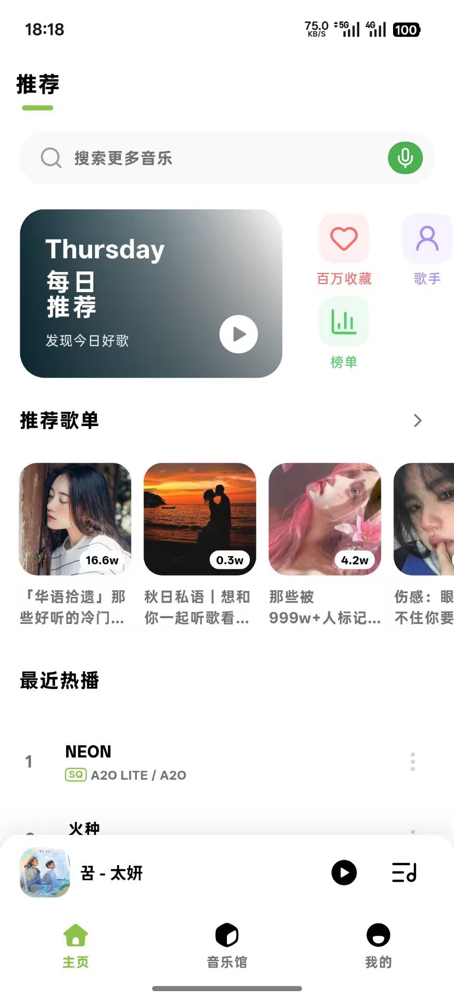
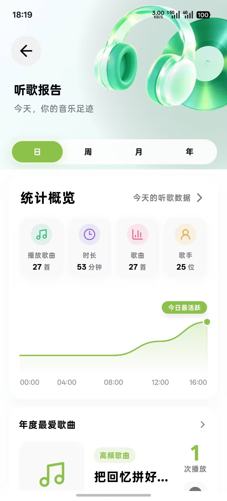
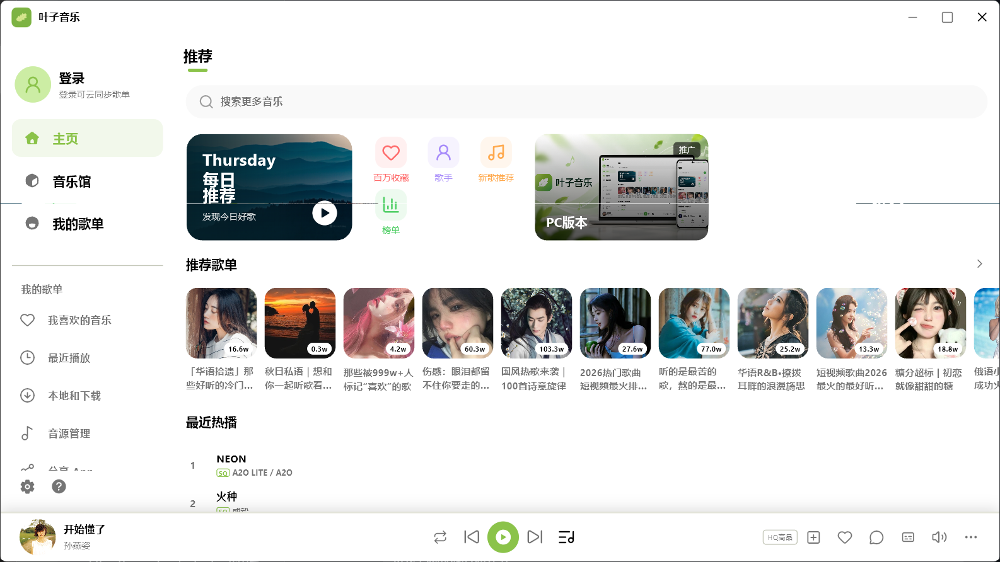
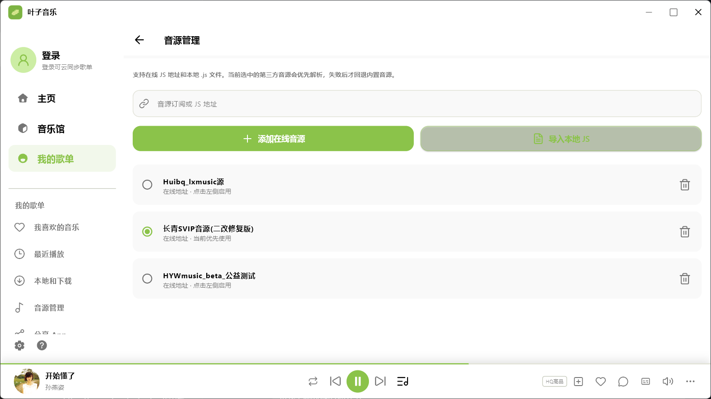
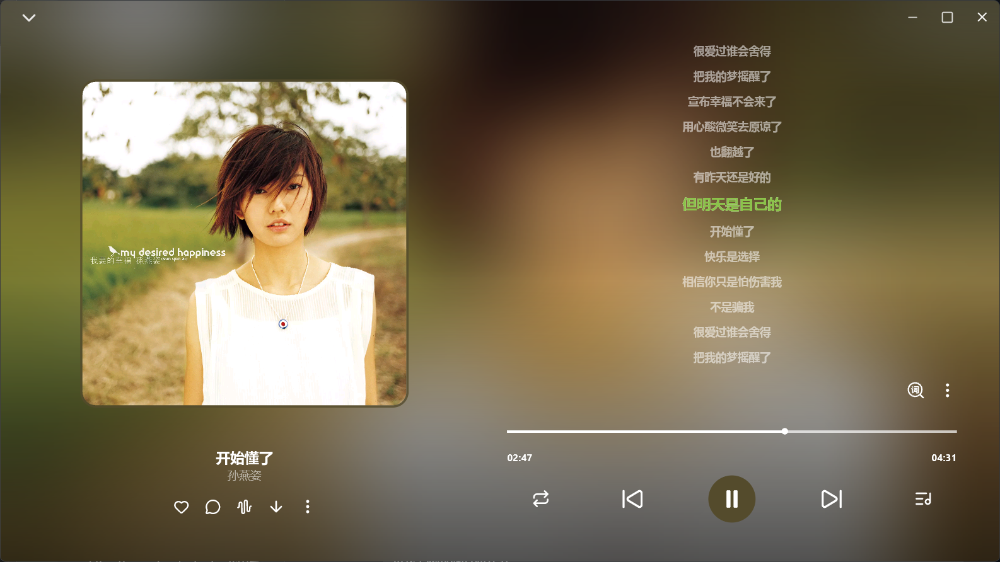
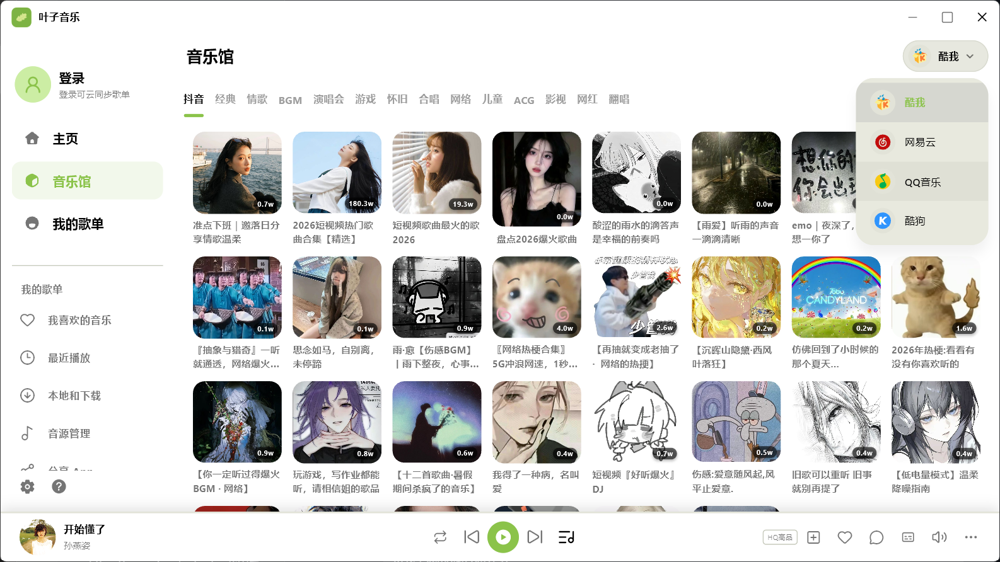
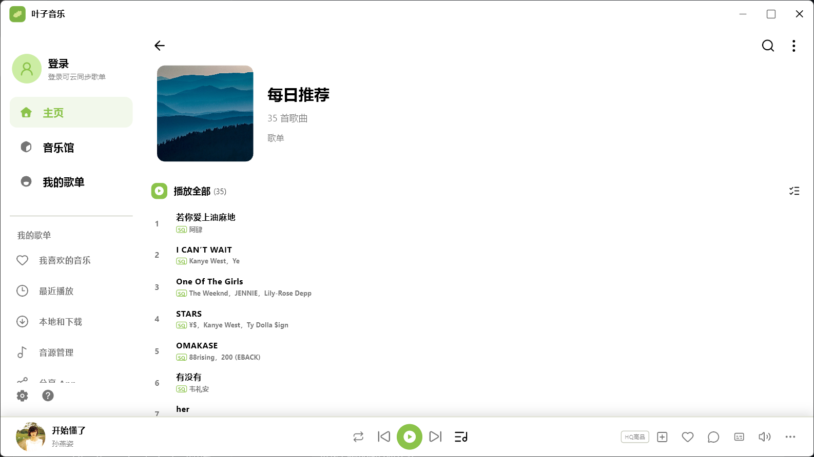

# 叶子音乐（YeziMusic）

  <strong>一个简洁、跨平台的音乐播放器</strong> 
  支持 Android 与 Windows，连接多种音源，随时搜索、播放和管理你的音乐。

  <a href="https://github.com/yezimm/yezimusic/releases/latest">下载最新版本</a>
  ·
  <a href="https://github.com/yezimm/yezimusic/releases">查看全部版本</a>

## 项目介绍

叶子音乐（YeziMusic）是一个基于 Flutter 开发的音乐播放器，提供手机端和 PC 端体验。应用支持内置音源与可扩展的 LX/JS 音源，并提供搜索、推荐、歌单、歌词、播放队列、下载和云端同步等功能。

项目目前主要面向 Android 和 Windows，界面会根据屏幕尺寸自动适配：手机端采用紧凑的底部导航和抽屉式菜单，PC 端提供更宽阔的多栏布局。

## 主要功能

- 支持 Android 手机端和 Windows PC 端。
- 支持内置音源、在线 JS 音源和本地 JS 音源管理。
- 支持网易云音乐、QQ 音乐、酷我、酷狗等音源接入（实际能力取决于音源配置）。
- 支持音乐搜索、每日推荐、音乐馆、歌单和最近播放。
- 支持歌词显示、播放队列、歌曲下载和本地音乐管理。
- 支持播放数据统计和听歌报告。
- 支持云端歌曲/歌单同步，方便在不同设备间使用。
- 支持手机端桌面歌词功能。
- 
## 界面预览

### 手机端

  
  
  
  
  

### PC 端

  
  

  
  

  

## 下载与安装

前往 [Releases](https://github.com/yezimm/yezimusic/releases/latest) 下载对应平台的安装包：

| 平台 | 文件 | 安装方式 |
| --- | --- | --- |
| Android | `.apk` | 下载后在手机上安装；如系统提示，请允许安装未知来源应用。 |
| Windows | 安装包或压缩包 | 下载后运行安装程序，或解压后启动应用。 |

## 音源配置

打开应用中的“音源管理”，可以选择内置音源、添加在线 JS 地址，或导入本地 JS 文件。不同音源的搜索范围和播放能力可能不同；使用第三方音源时，请遵守相关服务条款和版权规定。

## 项目状态

这是一个持续迭代中的 Flutter 音乐播放器项目。欢迎提交 Issue、反馈体验，或通过 Pull Request 改进功能。

## 许可证

本项目采用 [Unlicense](LICENSE) 许可证。

音乐内容、音源脚本及第三方服务由各自提供者负责。本项目仅提供播放器和音源管理功能，请勿将其用于未经授权的音乐传播。
